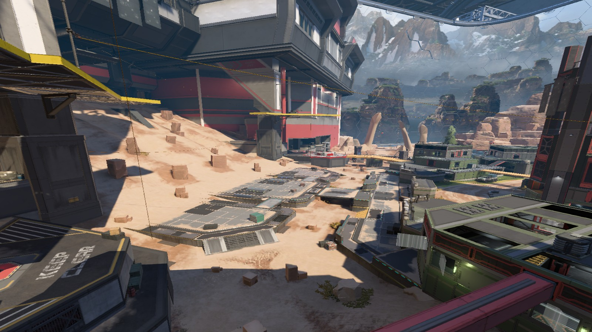

# R5Rust

**Apex Legends' Firing Range, rebuilt from scratch in Rust.** 
Rendering, lighting, collision, movement, weapons and ziplines ported from the game's own code and shaders.

[Launcher](https://github.com/R5Rust/launcher/releases/latest) · [Discord](https://discord.gg/kcmDzhJfk8) · [Credits](#credits)

 

Windows 10/11 x64 · needs Apex Legends installed (EA app or Steam) · free

 

<table>
<tr>
<td align="center" width="50%"> FR//02 and the town</td>
<td align="center" width="50%"> The range from above</td>
</tr>
</table>

Straight from the current build: no HUD, no edits.

## Get started

1. **[Download the launcher](https://github.com/R5Rust/launcher/releases/latest/download/R5Rust-Launcher.exe)** and run it.
   It installs itself (Start menu + desktop shortcut). If Windows says *"Windows protected your PC"*, press
   **More info > Run anyway** (the exe isn't code-signed yet).
2. Press **Download** to get the newest game build.
3. Press **Install**: it builds the game files from **your own Apex Legends install** (close Apex first). R5Rust ships
   no game files; this takes a while, once.
4. **Play.** The launcher keeps the game and itself up to date.

Questions, bugs, clips: **[Discord](https://discord.gg/kcmDzhJfk8)**.

## What's in it

- **Rendering:** the retail map and materials with the S30 shader code: lightmaps, light probes, cubemaps, cascaded
  sun shadows, triplanar rock blending, HDR sky + sun, auto exposure, bloom, the grading LUT, the game's static-prop
  fade and LOD rules.
- **Movement:** PlayerMove, walk, air, duck, slide, step, mantle, wall climb, wall jump and the lurch, ported from the
  binary; tracks real R5Flowstate within a few u/s.
- **Ziplines:** the map's ziplines with the game's use search, mount, ride and detach rules, and the use prompt.
- **Weapons:** the R-99 in first person (viewmodel animation, recoil, sounds, muzzle flash, impact decals) and heirlooms.
- **Loot:** the Firing Range's racks, ground loot, inventory and pickups.
- **Collision:** the game's own BVH collision and static-prop collision trees, not render triangles.
- **Next:** fog, water, zipline hands and view roll, then multiplayer (client + dedicated server).

## Repositories

| Repo | What |
|---|---|
| [R5Rust](https://github.com/R5Rust/R5Rust) | The game: wgpu client, dedicated server stub, shared movement sim, a doc for every ported system. Game builds are its Releases |
| [launcher](https://github.com/R5Rust/launcher) | The launcher: downloads + updates the game, builds the game files from your Apex install, launches it |
| [export-map](https://github.com/R5Rust/export-map) | Builds the map data (geometry, real collision, lighting, cubemaps, materials) from your own Apex install |
| [r5f-probe](https://github.com/R5Rust/r5f-probe) | Ground truth: scripted inputs and camera poses played in real R5Flowstate, logged and screenshotted |
| [docs](https://github.com/R5Rust/docs) | How the Apex mechanics work and how R5Rust reproduces them (movement so far) |
| [rsx](https://github.com/R5Rust/rsx) | R5Flowstate's RSX with our patches: the source of the extractor the installer uses |

## Credits

R5Rust stands on a lot of other people's work. Thank you.

**Apex Legends and its community**
- [Respawn Entertainment](https://www.respawn.com/) / Electronic Arts: Apex Legends, the Firing Range, and every asset R5Rust reads from your own install.
- [R5Flowstate](https://github.com/R5Flowstate): the reference game R5Rust is measured against (S30 and S21 clients and dedicated server, scripts, SDK).
- [r5ed](https://github.com/R5Flowstate/r5ed) (R5Flowstate): the `rbsp`, `rcomp` and `rpak` crates `export-map` reads the map and paks with.
- [RSX](https://github.com/r-ex/rsx) by r-ex, and [R5Flowstate's fork](https://github.com/R5Flowstate/rsx): asset extraction (textures, materials, shaders, models, sounds). AGPL-3.0; our patches are in [R5Rust/rsx](https://github.com/R5Rust/rsx).

**Tools**
- [Ghidra](https://ghidra-sre.org/) (NSA): reverse engineering the game's movement, rendering and zipline code.
- [DirectX Shader Compiler](https://github.com/microsoft/DirectXShaderCompiler) (Microsoft): reading the game's shaders.
- [PowerShell](https://github.com/PowerShell/PowerShell), [Python](https://www.python.org/), [NumPy](https://numpy.org/) and [Pillow](https://python-pillow.org/): the install pipeline.
- [Claude Code](https://claude.com/claude-code) (Anthropic): AI pair-programmer on much of the code and docs.

**Rust crates**
- [wgpu](https://github.com/gfx-rs/wgpu), [winit](https://github.com/rust-windowing/winit), [egui / eframe](https://github.com/emilk/egui), [glam](https://github.com/bitshifter/glam-rs), [cpal](https://github.com/RustAudio/cpal), [image](https://github.com/image-rs/image), [rayon](https://github.com/rayon-rs/rayon), [intel_tex_2](https://github.com/Traverse-Research/intel-tex-rs-2), [bcdec_rs](https://crates.io/crates/bcdec_rs), [serde](https://serde.rs/), [ureq](https://github.com/algesten/ureq), [zip](https://github.com/zip-rs/zip2) and everything they build on.

**Fonts** (launcher, SIL Open Font License): [Inter](https://rsms.me/inter/), [Barlow Condensed](https://github.com/jpt/barlow), [JetBrains Mono](https://www.jetbrains.com/lp/mono/).

**Made by Kainz.**

R5Rust is a fan project. It isn't affiliated with or endorsed by Respawn Entertainment or Electronic Arts. Apex
Legends is a trademark of Electronic Arts Inc. R5Rust distributes no game files: everything game-made is built on your
PC from your own copy of the game.
