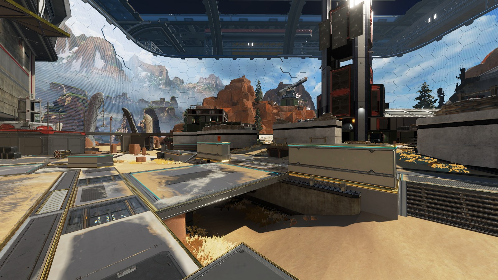
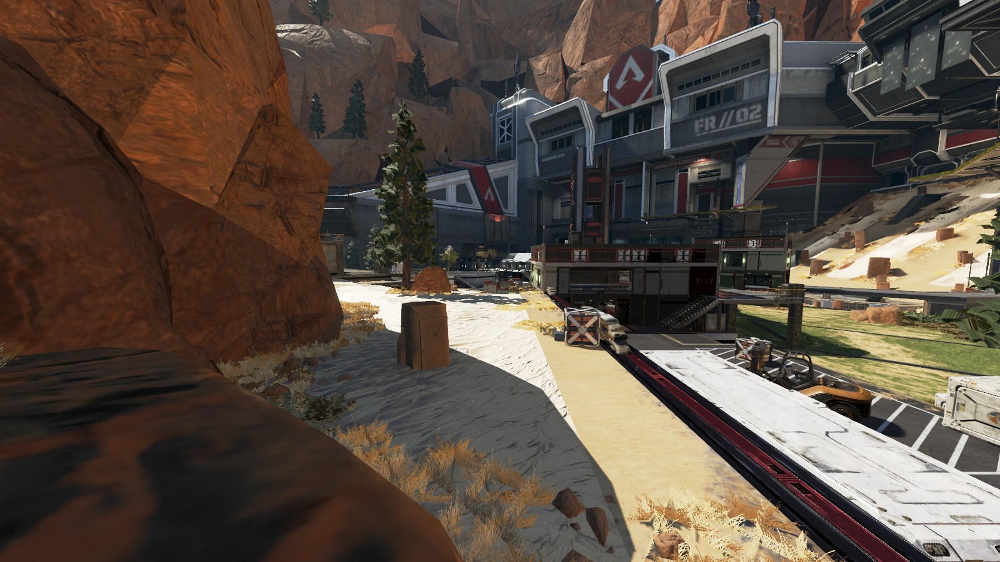
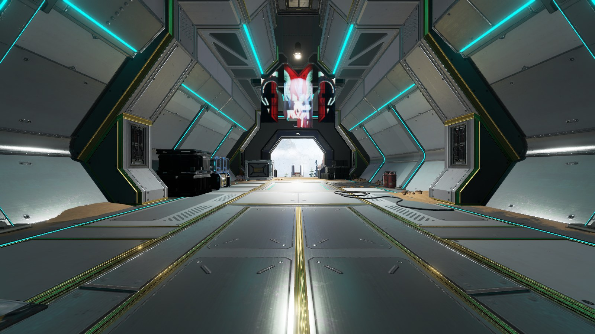

# R5Rust

A from-scratch **Rust** reimplementation of Apex Legends' Firing Range (the S21 build R5Flowstate runs): rendering,
lighting, collision and movement ported from the game's own decompiled code and measured against the real game.
No game assets are distributed; everything is extracted from your own install.

| | |
|---|---|
|  |  |

## Repositories

| Repo | What |
|---|---|
| [R5Rust](https://github.com/R5Rust/R5Rust) | The game: wgpu client, dedicated server stub, shared movement sim, docs on every ported system |
| [export-map](https://github.com/R5Rust/export-map) | Builds map data (geometry, real collision, lighting lumps, cubemaps, materials) from your own Apex install |
| [r5f-probe](https://github.com/R5Rust/r5f-probe) | Ground truth: plays scripted inputs and camera poses in real R5Flowstate and logs/screenshots them |
| [docs](https://github.com/R5Rust/docs) | How the Apex mechanics work and how R5Rust reproduces them: movement so far |

## Where it is

- **Movement:** Apex's PlayerMove / walk / air / duck / slide / step / mantle, mantle boost, wall climb + wall jump,
  and the S21 client's lurch (jump grace), ported from the binaries. Walk, sprint, jumps, slides, lurches and
  LiTTle's Forward RAS track real R5Flowstate within a few u/s.
- **Collision:** the game's own BVH4 collision + static prop collision trees, not render triangles.
- **Rendering:** Apex's world/prop shading (lightmaps, light probes, RTL pages, cubemaps, cascaded sun shadows with the
  map's no-shadow flags), the 3D skybox, auto exposure, bloom, the HDR grading LUT and S21's tonemap (function 4),
  all decoded from the shaders and the engine's CPU code.
- **Next:** blended terrain overlays, water, a few black materials, mid-air wall sticking, then client/server.
